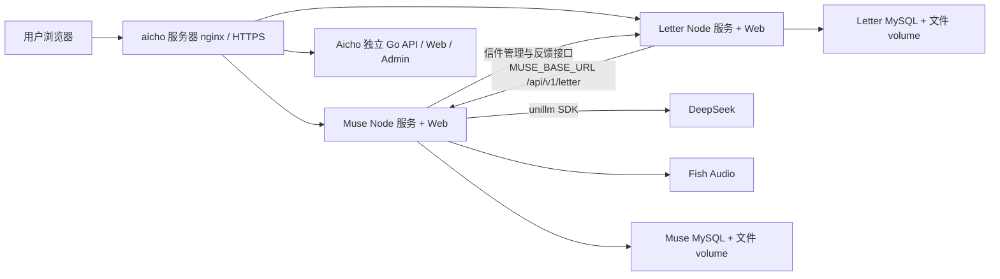

# Muse / Letter / Aicho 项目关系与部署交接

整理日期：2026-10-13。本文件供 Codex 项目中的新聊天读取。

## 代码与服务边界

| 服务 | 本地仓库 | 入口 | 职责 |
| --- | --- | --- | --- |
| Muse | `/Users/dan_zai/Git/aicho-muse` | https://imuse.chat | 文学作品、书籍编辑、写作 agent、正文 diff、人设音色、协作、管理后台 |
| Letter | `/Users/dan_zai/Git/aicho-muse-letter` | https://letter.imuse.chat | 写信、分段回信、信箱、分享、音频播放；调用 Muse 的信笺接口 |
| Aicho | `/Users/dan_zai/Git/Aicho` | https://aicho.chat | 独立 AI 陪伴应用，Go API、独立管理后台及前端 |
| unillm SDK | `/Users/dan_zai/Git/unillm-sdk` | SDK 依赖 | Muse 的模型接入库，非必须独立部署的 HTTP 服务 |

Muse 与 Letter 是两个独立 Compose 项目。Letter 加入外部网络 `aicho-muse_default` 后，通过 `http://aicho-muse-app:3001/api/v1/letter` 访问 Muse。不要用 Letter 容器里的 localhost 指向 Muse。

## 生产部署信息及证据边界

用户已明确：当前均部署到 `ssh aicho`。SSH 别名历史指向 `38.76.221.196:39898`，以本机 SSH config 为准，不在文档保存凭据。

下表是本聊天此前服务器实测记录，2026-10-13 尚未重新确认：本次 SSH 尝试被远端关闭连接。下次部署先核实实际目录和 Compose 标签。

| 组件 | 容器 | 历史宿主端口 → 容器端口 |
| --- | --- | --- |
| Muse 应用 | `aicho-muse-app` | 3002 → 3001 |
| Muse 数据库 | `aicho-muse-mysql` | MySQL 3306，容器内部 |
| Letter 应用 | `aicho-muse-letter-app` | 3004 → 3004 |
| Letter 数据库 | `aicho-muse-letter-mysql` | MySQL 3306，容器内部 |
| Aicho API | `aicho-api` | 3001 → 3001 |
| Aicho Web / Admin | `aicho-web-app` / `aicho-admin` | 3333 / 3334 → 80 |
| Aicho 依赖 | `aicho-redis` / `aicho-qdrant` | 独立 Redis / Qdrant |

Muse 持久卷为 `aicho-muse_mysql_data`、`aicho-muse_app_data`；Letter 为 `aicho-muse-letter_letter_mysql_data`、`aicho-muse-letter_letter_app_data`（历史实测）。Aicho 历史使用 SQLite `/opt/aicho/data/aicho.db`，与 Muse/Letter 的 MySQL 无关。

## 配置关系

- Muse：`LLM_PROVIDER/LLM_API_KEY/LLM_MODEL/LLM_BASE_URL` 与 `TTS_PROVIDER/TTS_API_KEY/TTS_MODEL/TTS_BASE_URL`。配置也可能在管理后台落库，排查时同时看配置读取优先级。
- Letter：`MUSE_BASE_URL` 指向 Muse 信笺接口；`FEEDBACK_ADMIN_TOKEN` 与 Muse 的 `LETTER_FEEDBACK_TOKEN` 必须一致。
- Muse 管理信件：`LETTER_BASE_URL` 指向 Letter API，`LETTER_PUBLIC_URL` 用于生成公开分享链接，应使用 `https://letter.imuse.chat`。源码部分默认地址仍是旧域名，不能把默认值当成生产配置。
- Aicho 使用不同变量：`DEEPSEEK_*`、`FISH_AUDIO_*`，不可直接复制 Muse 变量名。历史配置为 `deepseek-v4-flash-vision-exp`，实际可用模型需重新核对。
- 旧 dz 使用过 mihomo/Clash 转发 Fish 请求；新服务器是否需要代理须按实际连通性确认，不能默认沿用旧代理。

## 工作与部署入口

- Muse 前端 `web/`，后端 `server/src/`，Compose 为仓库根目录 `docker-compose.yml`，镜像构建入口 `server/Dockerfile`。
- Letter 前端 `web/`，后端 `server/src/`，Compose 与 Dockerfile 位于 Letter 仓库根目录。
- Muse 本地构建：`npm run build`；启动后端：`npm run start`。Letter 构建：`npm run build:web`。
- 健康检查：两个 Node 服务均提供 `/api/v1/health`。
- 更新前用 `docker inspect` 查询 `com.docker.compose.project.working_dir` 与 `com.docker.compose.project.config_files`，再在对应目录执行 Compose；备份持久化数据，保留生产 env。
- 本聊天历史：2026-10-08 Aicho 后台修复已推送 `58653a5` 与部署文档 `7d4ac77`，当时 API 镜像 `aicho-backend:vv1.0.7`。这是 Aicho 的变更，不能作为 Muse 当前版本。

## 文档优先级与后续聊天

`AGENTS.md` 是新 agent 的入口；本文件描述跨仓库关系；产品详情见 `PRODUCT_DESIGN.md`、`UX_DESIGN.md`、`ARCHITECTURE.md`。`OPS_GUIDE.md` 有旧 dz / 旧域名记录，仅用于历史参考，部署以服务器当前状态为准。

在 Codex 把 `/Users/dan_zai/Git/aicho-muse` 添加为项目后，在项目内开新聊天即可自动读取根目录 `AGENTS.md`。Letter 任务需读取本文件后到 Letter 仓库修改；跨服务任务分别提交各仓库，不混淆数据库与部署目标。
